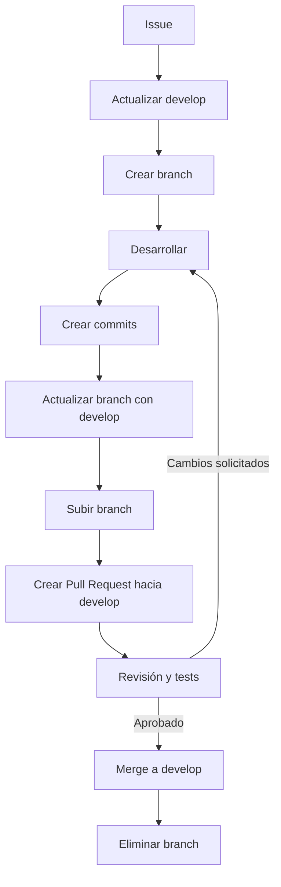

# Flujo de trabajo con Issues, Branches y Pull Requests

Guía del equipo para trabajar de forma ordenada en el repositorio: cada cambio nace de un **Issue**, se desarrolla en su propia **branch** y se integra a `develop` mediante un **Pull Request** revisado.

## Índice

1. [Crear o seleccionar el Issue](#1-crear-o-seleccionar-el-issue)
2. [Actualizar la branch `develop`](#2-actualizar-la-branch-develop)
3. [Crear una branch para el Issue](#3-crear-una-branch-para-el-issue)
4. [Realizar los cambios](#4-realizar-los-cambios)
5. [Crear commits](#5-crear-commits)
6. [Actualizar la branch antes del Pull Request](#6-actualizar-la-branch-antes-del-pull-request)
7. [Subir la branch a GitHub](#7-subir-la-branch-a-github)
8. [Crear el Pull Request](#8-crear-el-pull-request)
9. [Revisión y validaciones](#9-revisión-y-validaciones)
10. [Hacer merge hacia `develop`](#10-hacer-merge-hacia-develop)
11. [Eliminar la branch después del merge](#11-eliminar-la-branch-después-del-merge)
- [Flujo resumido](#flujo-resumido)
- [Comandos básicos (chuleta)](#comandos-básicos-chuleta)
- [Reglas de oro](#reglas-de-oro)

---

## 1. Crear o seleccionar el Issue

Antes de escribir código, crea o selecciona un Issue que describa el trabajo.

El Issue debe incluir:

- [ ] Qué se necesita hacer.
- [ ] Criterios de aceptación.
- [ ] Evidencia o capturas, si aplica.
- [ ] Responsable asignado.
- [ ] Agregado al **Project** correspondiente.

> 💡 Anota el **número del Issue** (por ejemplo `#123`); lo usarás en la branch, en el PR y en el cierre automático.

---

## 2. Actualizar la branch `develop`

Siempre comienza desde la versión más reciente de `develop`:

```bash
git checkout develop
git pull origin develop
```

---

## 3. Crear una branch para el Issue

La branch se crea **desde `develop`** e incluye el número del Issue:

```bash
git checkout -b feature/123-descripcion-corta
```

### Convención de nombres

| Prefijo     | Uso                                   | Ejemplo                          |
|-------------|---------------------------------------|----------------------------------|
| `feature/`  | Nueva funcionalidad                   | `feature/123-filtro-usuarios`    |
| `fix/`      | Corrección de un error                | `fix/123-corregir-error`         |
| `hotfix/`   | Error urgente en producción           | `hotfix/123-error-urgente`       |
| `refactor/` | Mejora interna sin cambiar el comportamiento | `refactor/123-mejorar-servicio` |

Reglas:

- Todo en minúsculas.
- Palabras separadas por guiones (`-`).
- Descripción corta (3–5 palabras).

---

## 4. Realizar los cambios

- Haz cambios **pequeños** y relacionados **únicamente** con el Issue.
- Si encuentras otro problema, crea un Issue nuevo en lugar de mezclarlo.

Para revisar el estado en cualquier momento:

```bash
git status
```

---

## 5. Crear commits

Agrega los cambios y crea un commit descriptivo:

```bash
git add .
git commit -m "feat: agregar filtro de usuarios"
```

### Tipos de commit

| Tipo        | Cuándo usarlo                              | Ejemplo                                   |
|-------------|--------------------------------------------|-------------------------------------------|
| `feat`      | Nueva funcionalidad                        | `feat: agregar nueva funcionalidad`       |
| `fix`       | Corrección de un error                     | `fix: corregir validación de correo`      |
| `refactor`  | Reorganizar código sin cambiar su función  | `refactor: reorganizar servicio de pagos` |
| `test`      | Agregar o modificar pruebas                | `test: agregar pruebas de autenticación`  |
| `docs`      | Documentación                              | `docs: actualizar documentación`          |

> 💡 Revisa con `git status` antes de `git add .` para no subir archivos que no corresponden (por ejemplo `.env`, `node_modules/`, archivos temporales).

---

## 6. Actualizar la branch antes del Pull Request

Antes de abrir el PR, trae los últimos cambios de `develop` a tu branch:

```bash
git checkout develop
git pull origin develop
git checkout feature/123-filtro-usuarios
git merge develop
```

Si existen conflictos:

1. Ábrelos en el editor y resuélvelos.
2. Verifica que el proyecto siga funcionando.
3. Confirma la resolución:

```bash
git add .
git commit
```

---

## 7. Subir la branch a GitHub

```bash
git push -u origin feature/123-filtro-usuarios
```

> La opción `-u` solo es necesaria la primera vez; después basta con `git push`.

---

## 8. Crear el Pull Request

En GitHub:

| Campo              | Valor                                          |
|--------------------|------------------------------------------------|
| **Base branch**    | `develop`                                      |
| **Compare branch** | La branch creada para el Issue                 |
| **Título**         | Tipo de cambio + descripción + número de Issue |

Ejemplo de título:

```text
feat: agregar filtro de usuarios (#123)
```

### Plantilla de descripción

```markdown
## Resumen
Breve descripción de los cambios realizados.

## ¿Cómo se probó?
- Pasos seguidos para validar el cambio.
- Tests ejecutados.

## Consideraciones
- Cambios en base de datos, variables de entorno, dependencias, etc.

## Capturas (si aplica)

Closes #123
```

> `Closes #123` cierra automáticamente el Issue cuando el PR se integra.

---

## 9. Revisión y validaciones

Antes del merge:

- [ ] Revisar el código.
- [ ] Ejecutar los tests necesarios.
- [ ] Confirmar que pasen los checks automáticos.
- [ ] Resolver los comentarios de revisión.
- [ ] Obtener la aprobación requerida.

Si se solicitan cambios, se hacen en la **misma branch** y el PR se actualiza solo:

```bash
git add .
git commit -m "fix: atender comentarios de revisión"
git push
```

---

## 10. Hacer merge hacia `develop`

El flujo correcto es:

```text
feature/123-filtro-usuarios → develop
```

- El merge se hace **desde el Pull Request**, después de completar la revisión y las validaciones.
- Se recomienda **Squash and merge** para mantener un historial limpio.
- ⚠️ **No** se hace merge directamente hacia `main`, salvo cuando el proceso de publicación del proyecto lo requiera.

---

## 11. Eliminar la branch después del merge

Una vez confirmado que el PR fue integrado:

```bash
git checkout develop
git pull origin develop
git branch -d feature/123-filtro-usuarios
git push origin --delete feature/123-filtro-usuarios
```

> Si usaste **Squash and merge**, Git puede decir que la branch "no está completamente integrada". En ese caso usa `git branch -D feature/123-filtro-usuarios` (solo después de confirmar que el PR sí se integró).

---

## Flujo resumido



---

## Comandos básicos (chuleta)

```bash
# 1. Partir de develop actualizado
git checkout develop
git pull origin develop

# 2. Crear la branch del Issue
git checkout -b feature/123-descripcion-corta

# 3. Realizar cambios y hacer commits
git add .
git commit -m "tipo: descripción del cambio"

# 4. Actualizar la branch con develop
git checkout develop
git pull origin develop
git checkout feature/123-descripcion-corta
git merge develop

# 5. Subir la branch y abrir el PR en GitHub
git push -u origin feature/123-descripcion-corta

# 6. Después del merge: limpiar
git checkout develop
git pull origin develop
git branch -d feature/123-descripcion-corta
git push origin --delete feature/123-descripcion-corta
```

---

## Reglas de oro

1. **Sin Issue no hay branch.**
2. **Nunca** trabajar ni hacer commits directamente en `develop` o `main`.
3. Una branch = un Issue.
4. Commits pequeños y con mensajes claros.
5. Todo cambio entra a `develop` mediante un Pull Request revisado.
6. Borrar la branch después del merge.
